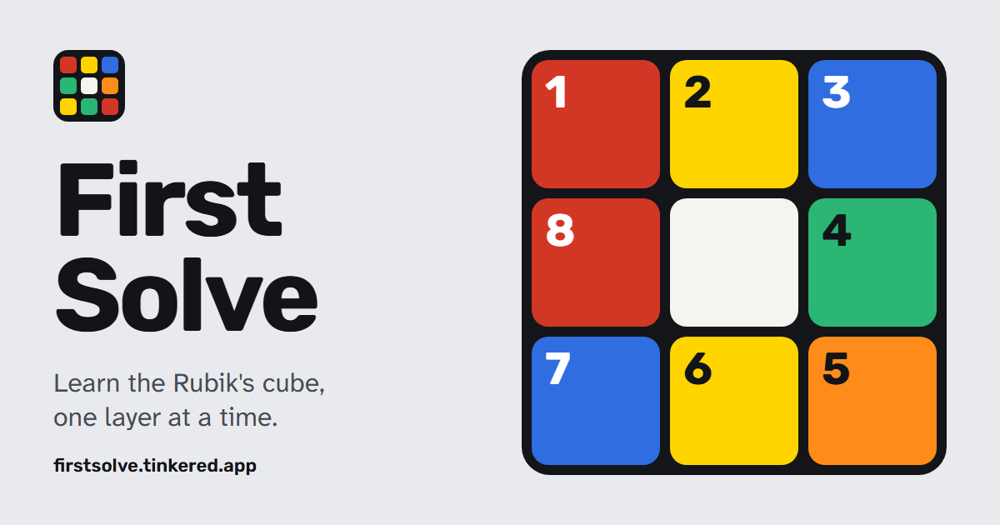

  

# First Solve

An interactive course that teaches the beginner layer-by-layer Rubik's Cube solve in eight steps,
with a live 3D cube instead of static diagrams. English by default, Polish behind the language
toggle.

Live at <https://firstsolve.tinkered.app>. It installs as an app and works offline.

## The course

Each step is a handful of slides. A slide shows the cube in the state the text describes, and
where there is an algorithm it plays on that cube, at a speed you choose.

| Step | What you learn |
|---|---|
| 1. Meet the cube | Centres, edges and corners, and how to read `R U R' U'` |
| 2. The daisy | Four white edges around the yellow centre |
| 3. White cross | Dropping each petal onto the centre of its side colour |
| 4. White corners | The corner inserter, `R U R' U'` |
| 5. Middle layer | Sending an edge right or left, and freeing one stuck in the wrong slot |
| 6. Yellow cross | The dot, the L and the line, with `F R U R' U' F'` |
| 7. Yellow edges | Moving the cross edges round until they match the sides |
| 8. Yellow corners | Placing the last corners, then twisting them home |

The cheat sheet collects the six algorithms of the course, each with a cube that plays it, and a
key to the notation. Finished steps are remembered, so the home page shows where you stopped.

## Running it

Open [public/index.html](public/index.html) in a browser; it works straight from disk. To run it as
production does, see the commands in [AGENTS.md](AGENTS.md).

## Data

No accounts, no analytics, no server-side storage and no third-party requests (opened from disk,
the page loads the cube library from `cdn.cubing.net`). The browser's
`localStorage` keeps the chosen language, theme and finished steps on the device. The notice for
visitors is [public/privacy.html](public/privacy.html), linked from the footer.

## Restoring

The site is static assets on a Cloudflare Worker, with no Worker script and request logging turned
off ([wrangler.jsonc](wrangler.jsonc)). Restoring it means redeploying a known-good commit; there is
no server-side data to restore. Clearing the site's data in the browser resets the finished steps.

## Development

Commands, conventions and the parts that must not be changed are in [AGENTS.md](AGENTS.md).

## Credits

- Author: Kuba (kuba@tinkered.app)
- 3D cube: [cubing.js](https://github.com/cubing/cubing.js), vendored unmodified under MPL-2.0, see
  [public/vendor/cubing/NOTICE.md](public/vendor/cubing/NOTICE.md)
- Fonts: Rubik and Atkinson Hyperlegible Next, SIL Open Font License 1.1, licence texts in
  [public/fonts/](public/fonts)
